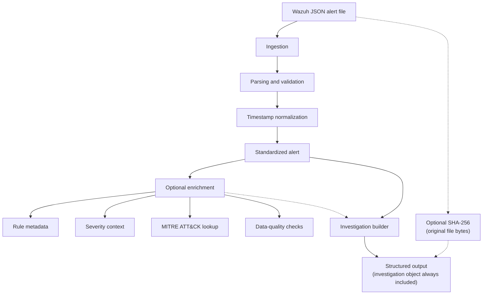

# Python SOC Automation Engine

A Python-based tool for processing exported Wazuh JSON alerts into structured, investigation-ready records.


## Contents

- [Why I Built This](#why-i-built-this)
- [Overview and Scope](#overview-and-scope)
- [Features](#features)
- [Architecture](#architecture)
- [Technology Stack](#technology-stack)
- [Installation and Quick Start](#installation-and-quick-start)
- [CLI Usage](#cli-usage)
- [Sample Output](#sample-output)
- [Testing](#testing)
- [Repository Structure](#repository-structure)
- [Documentation](#documentation)
- [Relationship to SENTINEL SOC Lab](#relationship-to-sentinel-soc-lab)
- [Roadmap](#roadmap)
- [Security Considerations](#security-considerations)
- [Author](#author)

## Why I Built This

While working with security alerts, I recognized that handling multiple incidents can involve repeatedly examining nested JSON, identifying relevant fields, understanding severity, and organizing information for investigation. Doing this manually becomes repetitive and time-consuming.

I wanted to build a Python engine that handles much of this processing: ingesting exported alerts, validating their structure, normalizing timestamps, optionally calculating integrity hashes, enriching available information, and producing structured investigation records. The project is also a way to develop practical Python, software engineering, and SOC automation skills.

It is developed independently of my separate SENTINEL SOC Lab project; see [Relationship to SENTINEL SOC Lab](#relationship-to-sentinel-soc-lab).

## Overview and Scope

Security alerts often arrive as nested JSON with fields that may be missing, inconsistent, or awkward to use downstream. This engine converts exported Wazuh alerts into a consistent, structured representation. Processing is transparent and predictable: the engine does not declare incidents, execute response actions, or replace analyst judgment.

**Scope and limitations**

- Input is exported Wazuh JSON files. There is no live Wazuh manager or API integration.
- No autonomous incident response and no complete case-management lifecycle. Investigation records are initial structured records, not complete investigations.
- The local MITRE ATT&CK dataset currently contains no rule mappings, so MITRE lookups return no results until validated mappings are added.
- Severity bands are engine-defined context, not official Wazuh severity classifications.
- No SENTINEL SOC Lab integration has been implemented.

## Features

| Area | Capability |
|------|------------|
| Ingestion | JSON file ingestion with UTF-8 BOM handling; Wazuh alert parsing and structural validation |
| Normalization | Timestamps normalized to UTC; the original timestamp is preserved, and missing or invalid values produce processing warnings rather than being treated as valid UTC |
| Integrity (optional) | SHA-256 calculated over the original input file bytes, before decoding and JSON parsing |
| Enrichment (optional) | Local Wazuh rule metadata, severity context, MITRE ATT&CK lookup, and data-quality checks |
| Investigation | An investigation-ready object generated for every successfully processed alert, with or without enrichment |
| Interface | CLI with JSON output to stdout or a file; flags for enrichment and integrity |
| Testing | Automated tests for individual components and the integrated workflow |

**Severity context.** The original numeric Wazuh level is always preserved; the context band is added alongside it.

| Wazuh level | Context |
|-------------|----------|
| 0 | Ignored |
| 1–4 | Low |
| 5–7 | Medium |
| 8–11 | High |
| 12–15 | Critical |

**MITRE ATT&CK.** Lookups are dataset-driven: a technique or tactic is returned only when a mapping exists, and the engine never invents associations. Enrichment status is reported as `complete`, `partial`, or `unavailable`.

## Architecture



The investigation builder runs for every successfully processed alert. Dotted lines mark optional paths: enrichment results feed the investigation when enabled, and the SHA-256 digest is attached to the final output as integrity metadata.

### Output envelope (schema version `1.2`)

| Field | Description |
|-------|-------------|
| `schema_version` | Output schema version |
| `record_type` | Identifies the record as a normalized alert |
| `source` | Identifies Wazuh and the ingestion method |
| `alert` | Normalized alert fields |
| `processing` | Warnings and optional integrity metadata (`algorithm`, `hash`) |
| `raw_alert` | Original alert object as parsed from the JSON input |
| `enrichment` | Enrichment results; included only when enrichment is enabled |
| `investigation` | Investigation-ready structure; always generated |

The SHA-256 hash is a checksum for detecting changes to the input file. It is not a digital signature or proof of an alert's authenticity.

### Investigation object

| Field | Purpose |
|-------|---------|
| `status` | Initial status (`new`) |
| `summary` | Alert description used as the initial summary |
| `affected_asset` | Agent name, plus reserved asset identifier and IP fields |
| `detection_details` | Rule ID, description, severity, groups, and available MITRE context |
| `priority` | Available severity classification and its source |
| `case_reference` | Reserved for a future case-management reference |
| `evidence` | Evidence list, initially empty |
| `analyst_notes` | Analyst notes list, initially empty |

The investigation structure does not fabricate asset information, evidence, notes, or conclusions. Fields that cannot be established from available data remain empty or `null`. See [Architecture](docs/architecture.md) for more detail.

## Technology Stack

Python 3.10+, JSON, pytest, Git and GitHub.

## Installation and Quick Start

Requires Python 3.10 or later. Commands below use Windows PowerShell.

```powershell
git clone https://github.com/andyydz/python-soc-automation.git
cd python-soc-automation

python -m venv .venv
.\.venv\Scripts\Activate.ps1
```

If PowerShell blocks activation, allow scripts for the current session and activate again:

```powershell
Set-ExecutionPolicy -Scope Process -ExecutionPolicy Bypass
.\.venv\Scripts\Activate.ps1
```

Install the project in editable mode, plus pytest for the test suite:

```powershell
python -m pip install --upgrade pip
python -m pip install -e .
python -m pip install pytest
```

Process the sample alert:

```powershell
soc-automation data/sample_logs/wazuh_alert.json
```

Or run the CLI as a module:

```powershell
python -m soc_automation.cli data/sample_logs/wazuh_alert.json
```

## CLI Usage

| Option | Description |
|--------|-------------|
| `--help` | Display CLI help |
| `--sha256` | Calculate SHA-256 of the original input file |
| `--enrich` | Enable local alert enrichment |
| `-o`, `--output` | Save processed JSON to a specified file |

```powershell
# SHA-256 integrity verification
soc-automation data/sample_logs/wazuh_alert.json --sha256

# Alert enrichment
soc-automation data/sample_logs/wazuh_alert.json --enrich

# Export processed JSON (missing output directories are created automatically)
soc-automation data/sample_logs/wazuh_alert.json --output reports/processed_alert.json

# Combined options
soc-automation data/sample_logs/wazuh_alert.json --enrich --sha256 --output reports/enriched_alert.json
```

The CLI exits with `0` on successful processing and `1` on handled processing or file errors. Invalid arguments are handled by `argparse`.

## Sample Output

A simplified illustration of the output structure. It is not a recorded execution result, and the `raw_alert`, `source`, `processing`, and optional `enrichment` fields are omitted.

```json
{
  "schema_version": "1.2",
  "record_type": "normalized_alert",
  "alert": {
    "rule_id": "5710",
    "severity": 5,
    "agent": "ubuntu-server",
    "description": "sshd: Attempt to login using a non-existent user",
    "timestamp_original": "2025-01-15T10:32:45+00:00",
    "timestamp_utc": "2025-01-15T10:32:45Z"
  },
  "investigation": {
    "status": "new",
    "summary": "sshd: Attempt to login using a non-existent user",
    "affected_asset": {
      "agent_name": "ubuntu-server",
      "asset_identifier": null,
      "ip_address": null
    },
    "detection_details": {
      "rule_id": "5710",
      "description": "sshd: Attempt to login using a non-existent user",
      "severity": 5,
      "groups": [],
      "mitre_techniques": [],
      "mitre_tactics": []
    },
    "priority": {
      "label": null,
      "reason": null,
      "source": null
    },
    "case_reference": null,
    "evidence": [],
    "analyst_notes": []
  }
}
```

See [Sample Output](docs/sample-output.md) for additional examples.

## Testing

pytest tests cover parsing and validation (including missing and malformed input), timestamp normalization, file ingestion, SHA-256 calculation, rule metadata, severity, MITRE lookup, data-quality checks, investigation generation, pipeline integration with and without enrichment, and CLI behavior (arguments, output, export, combined options, exit codes).

```powershell
python -m pytest -v
```

See [Testing Strategy](docs/testing.md) for details.

## Repository Structure

```text
python-soc-automation/
├── .github/
│   └── ISSUE_TEMPLATE/
├── data/
│   ├── wazuh_rules.json
│   ├── mitre_attack.json
│   └── sample_logs/
│       └── wazuh_alert.json
├── docs/
│   ├── architecture.md
│   ├── development-log.md
│   ├── integration-contract.md
│   ├── sample-output.md
│   └── testing.md
├── src/
│   └── soc_automation/
│       ├── enrichment/
│       │   ├── __init__.py
│       │   ├── engine.py
│       │   ├── mitre.py
│       │   ├── rule_metadata.py
│       │   ├── severity.py
│       │   └── data_quality.py
│       ├── investigation/
│       │   ├── __init__.py
│       │   └── builder.py
│       ├── __init__.py
│       ├── cli.py
│       ├── ingestion.py
│       ├── integrity.py
│       ├── normalizer.py
│       ├── parser.py
│       └── pipeline.py
├── tests/
│   ├── test_cli.py
│   ├── test_data_quality.py
│   ├── test_engine.py
│   ├── test_ingestion.py
│   ├── test_integrity.py
│   ├── test_investigation.py
│   ├── test_mitre.py
│   ├── test_normalizer.py
│   ├── test_parser.py
│   ├── test_pipeline.py
│   ├── test_rule_metadata.py
│   └── test_severity.py
├── .gitignore
├── CODE_OF_CONDUCT.md
├── CONTRIBUTING.md
├── LICENSE
├── SECURITY.md
├── pyproject.toml
├── pytest.ini
└── README.md
```

The tree shows the main project components; other configuration files may also exist.

## Documentation

- [Architecture](docs/architecture.md)
- [Testing Strategy](docs/testing.md)
- [Sample Output](docs/sample-output.md)
- [Integration Contract](docs/integration-contract.md)
- [Development Log](docs/development-log.md)
- [Contributing Guidelines](CONTRIBUTING.md)
- [Security Policy](SECURITY.md)
- [Code of Conduct](CODE_OF_CONDUCT.md)
- [License](LICENSE)

## Relationship to SENTINEL SOC Lab

I wanted to understand how a Security Operations Center works in practice, which led me to build [SENTINEL SOC Lab](https://github.com/andyydz/sentinel-soc-lab), a separate virtual SOC environment built around Wazuh, an Ubuntu endpoint, and a Kali Linux VM planned for controlled testing. It is where I explore security monitoring, detection engineering, incident investigation, and evidence documentation.

Working with Wazuh events there showed me how repetitive it is to examine exported JSON, interpret alert fields, and organize findings. That motivated this project: a separate tool that automates alert ingestion, validation, normalization, optional enrichment, and investigation-record generation. SENTINEL is the environment for developing and testing detection workflows; this engine focuses on how exported alert data is processed and organized.

My long-term goal is for sanitized alert exports from SENTINEL to be processed by this engine. **The two repositories are currently independent, and no integration has been implemented.** The intended interface is outlined in the [Integration Contract](docs/integration-contract.md).

## Roadmap

**Completed**

- [x] Wazuh alert parsing, validation, and missing-field handling
- [x] Timestamp normalization and JSON file ingestion
- [x] Optional SHA-256 integrity verification
- [x] Local rule metadata, severity context, MITRE ATT&CK lookup, and data-quality checks
- [x] Investigation-ready output generation
- [x] Pipeline integration and automated tests
- [x] CLI with JSON export and options for enrichment and SHA-256, with tests

**Planned**

- [ ] Improved operational logging and error reporting
- [ ] Investigation status update interface
- [ ] Evidence and case-reference management
- [ ] Additional validated rule-to-ATT&CK mappings
- [ ] Sanitized real-world alert validation
- [ ] SENTINEL SOC Lab integration
- [ ] Additional SIEM input adapters

Reliable Wazuh processing takes priority over expanding to other SIEM platforms.

## Security Considerations

- Alert data is treated as untrusted input and validated before processing.
- Enrichment uses local datasets only; MITRE associations depend on available mappings.
- Do not commit credentials, production alert exports, or sensitive infrastructure details. Sanitize hostnames, usernames, IP addresses, and other identifying information before sharing samples.
- SHA-256 provides an integrity checksum, not authentication or non-repudiation.
- The project is under development and has not been independently security-audited. It is not intended to replace production SOC tooling or analyst review.

To report a vulnerability, see the [Security Policy](SECURITY.md).

## Author

[andyydz](https://github.com/andyydz)
