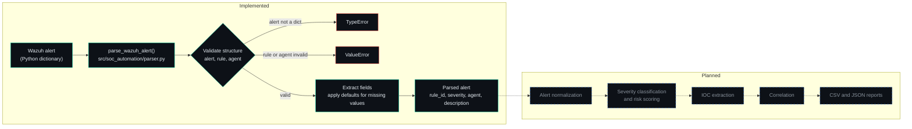

<div align="center">

# Python SOC Automation Engine

Python tooling that parses and validates Wazuh security alerts as the foundation for explainable SOC triage automation.


**Status: In development**

</div>

---

## Summary

Raw Wazuh alerts are nested JSON, and fields are not always present or well formed. Analysts repeatedly extract the same values by hand, and automation built on unvalidated input fails unpredictably.

This project addresses the first step of that problem. It takes a Wazuh alert as a Python dictionary, validates its structure, extracts the key fields and returns a consistent result. Invalid input raises specific exceptions, and missing fields fall back to defaults. The parser is covered by automated pytest tests.

**Built with:** Python 3, JSON, pytest, Git and GitHub.

The long-term goal is a SOC automation tool that applies explainable triage logic to Wazuh alerts and produces structured reports for analysts. Only the parser is implemented today. See [Roadmap](#roadmap) for planned work.

## Implemented

| Component | Description |
|---|---|
| Wazuh alert parser | `parse_wazuh_alert()` in `src/soc_automation/parser.py` |
| Field extraction | Returns `rule_id`, `severity`, `agent` and `description` |
| Input validation | Checks that the alert is a dictionary and that `rule` and `agent` have the expected dictionary structure |
| Error handling | Raises `TypeError` for a non-dictionary alert and `ValueError` for an invalid `rule` or `agent` structure |
| Missing-field handling | Uses default values when fields are absent or partially absent |
| Automated tests | `tests/test_parser.py`, run with pytest |
| Project setup | Python virtual environment, pytest configuration (`pytest.ini`), Git and GitHub version control |

The parser works on alerts already loaded as Python dictionaries. It has no connection to a live Wazuh manager and does not perform scoring, enrichment, correlation or reporting.

## Skills Demonstrated

| Area | Where it appears |
|---|---|
| Python programming | Parser function and project structure |
| Wazuh alert analysis | Selecting and extracting rule, severity and agent data from alert JSON |
| JSON parsing and data validation | Structural checks on the alert, `rule` and `agent` objects |
| Exception handling | Distinct `TypeError` and `ValueError` cases for invalid input |
| Automated testing | pytest tests covering valid, invalid and incomplete alerts |
| Version control | Git and GitHub workflow |

## Architecture

Solid lines show the current data flow. The dashed lines and the Planned block are future work and do not exist yet.



## Example

The sample below is illustrative. It shows the input and output format and is not a recorded execution result.

**Input: Wazuh alert**

```json
{
  "timestamp": "2025-01-15T10:32:45.123+0000",
  "rule": {
    "id": "5710",
    "level": 5,
    "description": "sshd: Attempt to login using a non-existent user"
  },
  "agent": {
    "id": "001",
    "name": "ubuntu-server"
  }
}
```

**Output: parsed alert**

```json
{
  "rule_id": "5710",
  "severity": 5,
  "agent": "ubuntu-server",
  "description": "sshd: Attempt to login using a non-existent user"
}
```

**Invalid and incomplete input**

| Input | Result |
|---|---|
| Alert is not a dictionary | `TypeError` |
| `rule` is not a valid dictionary | `ValueError` |
| `agent` is not a valid dictionary | `ValueError` |
| Missing or partially missing fields | Default values are used |

## Getting Started

Commands are for Windows PowerShell.

```powershell
git clone https://github.com/andyydz/python-soc-automation.git
cd python-soc-automation

python -m venv .venv
.\.venv\Scripts\Activate.ps1

python -m pip install --upgrade pip
python -m pip install pytest
```

If PowerShell blocks script activation, allow it for the current session only:

```powershell
Set-ExecutionPolicy -Scope Process -ExecutionPolicy Bypass
```

`pytest.ini` configures pytest to discover the `src` package and the `tests` directory, so the tests run from the repository root without extra path settings.

### Run the parser

The parser is a Python function without a command-line interface. Outside pytest, add `src` to the import path for the session, then call it:

```powershell
$env:PYTHONPATH = "src"
python
```

```python
from soc_automation.parser import parse_wazuh_alert

alert = {
    "rule": {"id": "5710", "level": 5, "description": "sshd: Attempt to login using a non-existent user"},
    "agent": {"id": "001", "name": "ubuntu-server"},
}

print(parse_wazuh_alert(alert))
```

### Run the tests

```powershell
python -m pytest -v
```

## Testing

Tests are in `tests/test_parser.py` and cover normal operation and failure cases:

- Normal Wazuh alert parsing
- Invalid alert input
- Invalid `rule` data
- Invalid `agent` data
- Alert with missing fields
- Alert with partially missing fields

The latest verified test run passed six tests. The count will change as the project grows.

## Repository Structure

```text
python-soc-automation/
├── data/
│   └── sample_logs/
│       └── wazuh_alert.json
├── src/
│   └── soc_automation/
│       ├── __init__.py
│       └── parser.py          # parse_wazuh_alert()
├── tests/
│   └── test_parser.py
├── .gitignore
├── pytest.ini
└── README.md
```

The `.venv` virtual environment is excluded from version control.

## Relationship to SENTINEL SOC Lab

SENTINEL SOC Lab is my hands-on environment for working with security monitoring and alert data. This project complements it by moving from reading alerts manually to processing them with code, and supports my development toward SOC automation and security operations work.

The two projects are currently separate. Integration is planned and has not been implemented. The intent is to apply this engine's parsing and triage logic to alerts generated in the lab.

## Roadmap

**Completed**

- Project setup and Git/GitHub version control
- Python virtual environment
- pytest configuration
- Wazuh alert parser
- Input validation
- Missing-field handling
- Parser test suite

**Planned (not implemented)**

- Alert normalization
- Rule-based severity classification
- Explainable risk scoring
- IOC extraction
- Alert correlation
- CSV and JSON reporting
- Improved logging and error handling
- SENTINEL SOC Lab integration

New features will build on the validated parser output, and scoring logic will stay transparent so any classification can be traced.

## Security Considerations

- Alert data comes from monitored systems and is treated as untrusted input. The parser validates structure before reading fields.
- The code makes no network connections and does not contact Wazuh or any external service.
- Do not commit credentials, Wazuh manager details or real production alerts. Remove hostnames, IP addresses and usernames from any exported alerts used as samples or test data.
- This project is under development and has not been hardened or audited. It is not intended for use in live security operations.

## Author

**andyydz** | [GitHub](https://github.com/andyydz)
