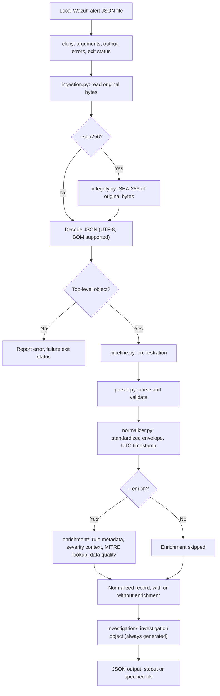

# Python SOC Automation Engine: Architecture

This document describes the implemented architecture of Python SOC Automation Engine as of Milestones 1 to 4. Future ideas are confined to the final section and are not current capabilities.

## 1. Overview

Python SOC Automation Engine is a modular Python project that processes exported Wazuh alert JSON files. It validates and normalizes each alert, optionally enriches it from local datasets, and produces a structured, investigation-ready JSON record.

Design principles:

- **Preserve original data.** The original alert is kept intact in `raw_alert`.
- **Keep sources of data separate.** Original data, normalized fields, enrichment, investigation output, and processing metadata live in distinct parts of the output.
- **Stay deterministic and explainable.** Derived values come from defined logic or local datasets and carry provenance. Missing values are not invented.
- **Validate untrusted input.** Input is checked before it is processed, and failures are reported clearly.
- **Stay minimal.** Runtime dependencies are currently empty in `pyproject.toml`. Enrichment uses local JSON datasets.

## 2. Scope and boundaries

| The engine does | The engine does not |
|---|---|
| Process a local Wazuh alert JSON file | Connect to a live Wazuh manager or Wazuh API |
| Produce a standardized, versioned JSON record | Execute autonomous incident response actions |
| Generate an investigation object with placeholders for analyst input | Provide a full case-management platform |
| Run as a CLI (`soc-automation`) or through its Python package | Integrate with SENTINEL SOC Lab or other SIEM platforms |

SENTINEL SOC Lab is a separate project. Integration is a future possibility and is not implemented.

## 3. Implementation status

| Milestone | Capabilities | Status |
|---|---|---|
| 1. Standardized Alert Output | JSON file ingestion, parsing and validation, original alert preservation, UTC timestamp normalization, optional SHA-256, processing warnings | Implemented |
| 2. Alert Enrichment | Local Wazuh rule metadata lookup, severity context, local MITRE ATT&CK lookup, data-quality checks, enrichment provenance and status | Implemented |
| 3. Investigation-Ready Output | Structured `investigation` object, pipeline integration | Implemented |
| 4. CLI and Integration Interface | Installable package, `soc-automation` CLI, JSON output to stdout or file | Implemented |

The current standardized output schema version is **1.2**. Automated tests are under `tests/` and run with `python -m pytest -v`.

## 4. Processing flow

Key ordering rule: when SHA-256 is enabled, the digest is computed over the exact original input bytes, before JSON decoding.

## 5. Module responsibilities

Source code is under `src/soc_automation/`.

| Module | Responsibility |
|---|---|
| `cli.py` | Command-line interface. Parses arguments, writes JSON to stdout or a file (creating missing output directories), reports errors, and sets the exit status. |
| `ingestion.py` | Reads the original file bytes, optionally calculates SHA-256, decodes JSON as UTF-8 with BOM support, validates that the top-level value is an object, and passes the alert into the pipeline. |
| `pipeline.py` | Orchestrates parsing, normalization, optional enrichment, and investigation output. |
| `parser.py` | Parses and structurally validates the Wazuh alert. |
| `normalizer.py` | Builds the standardized envelope and normalizes timestamps to ISO 8601 UTC. |
| `integrity.py` | Calculates the optional SHA-256 digest. |
| `enrichment/` | Local, dataset-driven enrichment: rule metadata, severity context, MITRE ATT&CK lookup, and data-quality checks. |
| `investigation/` | Builds the `investigation` object. |

## 6. Output structure and data separation

The output is a versioned JSON envelope (`schema_version` `1.2`). Each kind of data has its own place so that consumers can tell original facts from derived values.

| Category | Location | Notes |
|---|---|---|
| Original data | `raw_alert` | The preserved original alert. Authoritative source of truth. |
| Normalized fields | Standardized alert fields | Convenience copies and normalized values, such as the UTC timestamp. They do not replace `raw_alert`. |
| Enrichment | `enrichment` | Derived data with status, provenance, and error handling information, which varies by component. Present when enrichment is requested. |
| Investigation | `investigation` | Investigation-ready object. See section 8. |
| Processing metadata | Processing section | Engine metadata, processing warnings, and integrity metadata when SHA-256 is enabled. Describes what the engine did, not what the alert contains. |

Field-level definitions and examples are in [integration-contract.md](integration-contract.md). Consumers should check `schema_version` before reading other fields.

## 7. Enrichment

Enrichment is optional (`--enrich`) and uses only local datasets bundled with the project.

| Component | Behavior |
|---|---|
| Rule metadata | Looks up Wazuh rule metadata from a local dataset. |
| Severity context | Classifies the original rule level using engine-defined ranges (below). |
| MITRE ATT&CK | Looks up techniques in a local dataset. |
| Data-quality checks | Flags quality issues in the alert data. |
| Status, provenance, and errors | The enrichment output records status, provenance, and error handling. The exact metadata is not identical for every component; see the integration contract for per-component fields. |

Severity context ranges are defined by this engine. They are not a classification issued by Wazuh, and the original rule level is preserved.

| Rule level | Severity context |
|---|---|
| 0 | Ignored |
| 1 to 4 | Low |
| 5 to 7 | Medium |
| 8 to 11 | High |
| 12 to 15 | Critical |

Limitations:

- **The MITRE ATT&CK dataset currently has no verified rule mappings.** The lookup mechanism is implemented, but no actual technique mappings are populated. Alerts will not receive technique mappings until verified entries are added to the dataset.
- Mappings are never inferred or fabricated. A mapping appears only if it exists in the local dataset.
- Local datasets cover only what has been added to them and are not a complete copy of Wazuh's ruleset.
- Enrichment is a decision aid for analysts, not an authoritative assessment of the alert.

## 8. Investigation output

The pipeline always generates the `investigation` object for a processed alert, whether or not enrichment was requested. It contains:

- Investigation status.
- Affected asset fields.
- Detection details.
- Priority context, when enrichment is available.
- Case reference.
- Evidence.
- Analyst notes.

Initialization behavior:

| Field | Initial value |
|---|---|
| `evidence` | Empty list |
| `analyst_notes` | Empty list |
| `case_reference` | `null` |
| Asset fields | `null` unless supported by available data |

The engine does not invent asset information or analyst observations. The evidence and analyst-note fields are placeholders for later analyst input. The object is a structured record, not a case-management system: it does not track workflow, assignments, or case lifecycle.

## 9. Integrity handling (SHA-256)

- SHA-256 is optional and enabled with `--sha256`.
- The digest is computed over the exact original input bytes, before JSON decoding, not over re-serialized JSON.
- The result is recorded in the processing metadata.
- The digest supports **integrity comparison**: anyone holding the same file can recompute it and check for a match.
- The digest does **not** prove authenticity. It does not show who created the file, that the alert is genuine, or that the source is trustworthy.

## 10. CLI

The package is configured in `pyproject.toml` and supports editable installation (`python -m pip install -e .`). It provides the `soc-automation` entry point.

| Aspect | Behavior |
|---|---|
| Input | A local Wazuh JSON alert file. |
| `--sha256` | Adds SHA-256 integrity metadata. |
| `--enrich` | Adds local enrichment. |
| Output | JSON to stdout, or to a specified file. Missing output directories are created automatically. |
| Errors | Reported clearly, with a failure exit status. |

Run `soc-automation --help` for the exact argument syntax.

## 11. Validation and error handling

- The input file is read as bytes and decoded as UTF-8 JSON, with BOM support.
- The top-level JSON value must be an object. Other input is rejected with an error.
- Structural validation occurs in the parser. Problems are reported with context rather than silently defaulted.
- Non-fatal findings are recorded as processing warnings in the output instead of stopping processing.
- The CLI reports errors and sets a failure exit status.
- Malformed or hostile input must be handled safely. Contributors should add tests for such cases.

## 12. Future directions (not implemented)

The following are possibilities only. None is part of the current implementation.

- Integration with SENTINEL SOC Lab, a separate project.
- Support for other SIEM platforms, such as Splunk, Elastic, and Microsoft Sentinel.
- Verified MITRE ATT&CK rule mappings in the local dataset.
- Live Wazuh API ingestion.

Autonomous incident response and full case management are not part of the current scope. Any future disruptive response action would require human approval.
