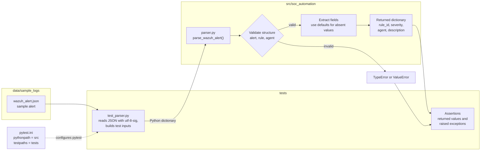
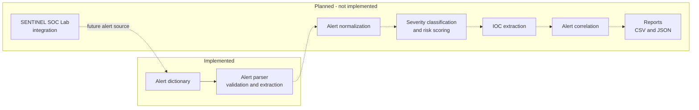

  # Architecture

Developer: Andrew Vinston D'Souza
Status: Milestone 1 (Wazuh alert parser) is complete. All other components described as planned are not implemented.

Related: [README](../README.md) | [Development log](development-log.md) | [Testing](testing.md) | [Sample output](sample-output.md)

## 1. Project Overview

Python SOC Automation Engine is a Python project that aims to automate repetitive Security Operations Center (SOC) tasks. The long-term objective is modular tooling that can process security alerts, validate event data, normalize alert information, apply explainable triage logic, identify indicators of compromise (IOCs), correlate related events and generate structured reports.

The project is developed incrementally. Only the first component, a Wazuh alert parser, exists today. It is not a production-ready SOC platform and is not a complete alert-processing engine.

## 2. Problem Statement and Motivation

Wazuh alerts are nested JSON documents. Analysts routinely extract the same values from them: which rule fired, how severe it is, which agent it came from and what it describes. Doing this by hand is repetitive, and automation built on the same data is only as dependable as its handling of input.

Two problems motivate the design:

- **Repetition.** Manual field extraction costs analyst time that could go to investigation.
- **Unreliable input.** Alerts can be incomplete or malformed. Code that fails unpredictably, or silently produces plausible but wrong output, is a risk in a security workflow.

The first milestone addresses both at the smallest useful scale: validate one alert and return a consistent set of fields.

## 3. Architecture Objectives

- Provide a validated, consistent representation of a Wazuh alert that later stages can build on.
- Keep each stage small enough to test independently.
- Fail visibly on malformed input rather than returning misleading results.
- Keep the system explainable, so that any future classification can be traced to the rules that produced it.

## 4. Design Principles

| Principle | Application |
|---|---|
| Modularity | Parsing lives in its own module, `parser.py`. Future stages are intended to be separate modules |
| Separation of concerns | Implementation (`src/`), tests (`tests/`) and sample data (`data/`) are kept apart |
| Input validation | Implemented. Structure is checked before fields are read |
| Explicit failure | Invalid input raises `TypeError` or `ValueError` |
| Testability | The parser takes a dictionary and returns a dictionary, so it can be tested without a Wazuh deployment |
| Explainability | A design goal for planned triage and scoring stages. Not yet applicable |
| Security-conscious handling | Alert data is treated as untrusted. Samples are kept sanitized and no credentials are stored in the repository |

## 5. Current System Architecture

The diagram shows only what is implemented: the parser and its test workflow.



## 6. Current Components

| Path | Responsibility |
|---|---|
| `src/soc_automation/parser.py` | `parse_wazuh_alert(alert: dict[str, Any]) -> dict[str, Any]`: validation, field extraction and default handling |
| `src/soc_automation/__init__.py` | Marks `soc_automation` as a Python package |
| `tests/test_parser.py` | Six automated tests covering normal, invalid and incomplete input |
| `data/sample_logs/wazuh_alert.json` | Sample alert used as test input |
| `pytest.ini` | Sets `pythonpath = src` and `testpaths = tests` |
| `.gitignore` | Excludes local and generated files, including the `.venv` virtual environment |
| `README.md` | Project summary, setup and roadmap |
| `docs/` | Technical documentation |

## 7. Current Data Flow

1. A sample Wazuh alert is stored as JSON in `data/sample_logs/wazuh_alert.json`.
2. The test opens the file with `encoding="utf-8-sig"`, which handles the UTF-8 byte order mark (BOM) the file was saved with.
3. The JSON is converted into a Python dictionary.
4. The dictionary is passed to `parse_wazuh_alert()`.
5. The parser validates the structure: the alert must be a dictionary, and the `rule` and `agent` structures must be dictionaries.
6. The rule ID, severity level, agent name and description are extracted. Absent fields receive default values.
7. A dictionary with those four fields is returned.
8. The tests assert on the returned values, or on the exception raised for invalid input.

The parser accepts a Python dictionary. It does not read JSON files, connect to a Wazuh manager, retrieve live alerts or perform incident response. File loading happens in the test code.

## 8. Input and Output Structure

**Input.** A Python dictionary representing a Wazuh alert. The fields the parser reads are `rule.id`, `rule.level`, `rule.description` and `agent.name`.

```json
{
  "rule": {
    "id": "550",
    "level": 7,
    "description": "Integrity checksum changed"
  },
  "agent": {
    "name": "SENTINEL-LINUX01"
  }
}
```

**Output.** A dictionary with four keys.

```json
{
  "rule_id": "550",
  "severity": 7,
  "agent": "SENTINEL-LINUX01",
  "description": "Integrity checksum changed"
}
```

| Output key | Source field |
|---|---|
| `rule_id` | `rule.id` |
| `severity` | `rule.level` |
| `agent` | `agent.name` |
| `description` | `rule.description` |

## 9. Parser Validation and Error Handling

| Condition | Behavior |
|---|---|
| Alert is not a dictionary | `TypeError` |
| `rule` is present but not a valid dictionary structure | `ValueError` |
| `agent` is present but not a valid dictionary structure | `ValueError` |
| Field is absent or partially absent | Default value is used. The values are defined in `parser.py` |

Validation is structural. It confirms the alert, `rule` and `agent` are dictionaries. It does not verify an alert against the full Wazuh schema.

**Why it matters.** In security automation, malformed input should not silently produce misleading results. A specific exception at the boundary makes the failure visible and lets the caller decide how to respond. Defaults for absent fields are an explicit, tested choice rather than a side effect of how the code happens to fail.

## 10. Planned Future Architecture

**Planned. Nothing in this section is implemented**, apart from the parser, which is the first stage.

| Stage | Intended purpose |
|---|---|
| Alert normalization | Consistent internal alert schema |
| Severity classification and risk scoring | Rule-based and explainable, with each result traceable to its rules |
| IOC extraction | Identify indicators in alert data |
| Alert correlation | Relate multiple alerts |
| Automated reporting | CSV and JSON output for analysts |
| Testing and quality improvements | Broader tests, logging and error handling |
| SENTINEL SOC Lab integration | Process alerts from the lab environment |

The order is an intended direction and may change.

## 11. Planned Architecture Diagram



## 12. Relationship with SENTINEL SOC Lab

SENTINEL SOC Lab is a separate project that uses Wazuh for security monitoring and file integrity monitoring.

- SENTINEL provides the monitoring environment.
- Wazuh generates the security alerts.
- This project is intended to process and analyze alert data of that kind.
- Future development may connect the two projects.

There is no confirmed live integration at present. The parser runs against a static sample and dictionaries supplied by tests.

## 13. Security Considerations

- **No real production logs in public examples.** Sample data is sanitized.
- **Credentials and infrastructure details** such as manager addresses, tokens, hostnames and IP addresses are not committed.
- **Untrusted input.** Alert content comes from monitored systems and may be attacker-influenced. Structure is validated before fields are read.
- **No unsafe use of extracted values.** Values taken from alerts are data only. They should never be passed to a shell, evaluated as code or used to build commands. The current parser only reads and returns them.
- **Sample review.** Any new sample alert should be checked for hostnames, addresses and usernames before it is committed.

## 14. Current Limitations

- Processes one alert dictionary per call.
- Extracts four fields only.
- Validation is structural and does not cover the full Wazuh alert schema.
- No file or batch ingestion in the parser, no live Wazuh connection and no scoring, enrichment, correlation or reporting.
- Test coverage has not been measured. See [Testing](testing.md).
- Not hardened or audited, and not intended for live security operations.

## 15. Future Architectural Improvements

- Add the planned stages as separate modules that consume the parser's validated output.
- Add a separate input layer for reading alert exports, keeping file handling out of the parser.
- Introduce logging and clearer error reporting.
- Extend the test suite with each new module.
-
