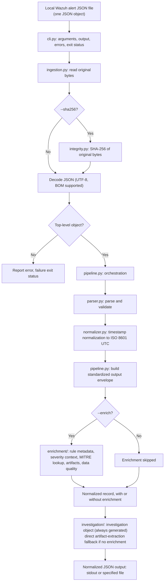
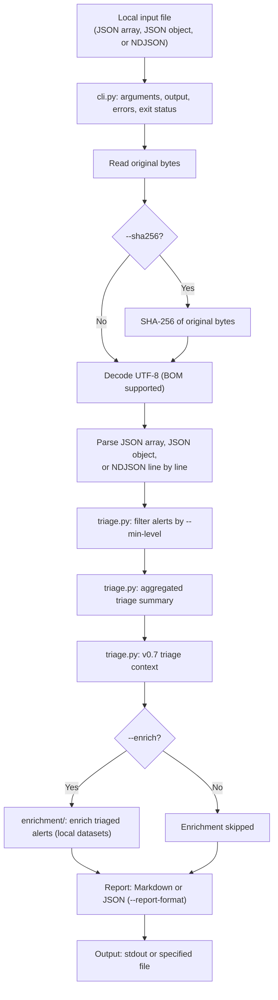

# Python SOC Automation Engine: Architecture

This document describes the implemented architecture of Python SOC Automation Engine as of Milestones 1 to 4. Future ideas are confined to the final section and are not current capabilities.

## 1. Overview

Python SOC Automation Engine is a modular Python project that processes exported Wazuh alert JSON files. It has two distinct CLI workflows:

| Workflow | Activation | Input | Output |
|---|---|---|---|
| Normal processing | Default | One Wazuh JSON alert object per file | Normalized, investigation-ready JSON record |
| Batch triage | `--triage` | A JSON array, a single JSON object, or NDJSON | Aggregated triage report (Markdown or JSON) |

**Normal processing** validates and normalizes a single alert, optionally adds a SHA-256 checksum and local enrichment, generates an investigation object, and writes normalized JSON to stdout or a file.

**Batch triage** is a separate workflow, not an extension of single-alert ingestion. It filters alerts by severity (`--min-level`), generates an aggregated summary, adds contextual analysis (FIM, SSH, Sysmon, and evasion-related context), and can optionally calculate SHA-256 and enrich the triaged alerts.

Design principles:

- **Preserve original data.** The original alert is kept intact in `raw_alert`.
- **Keep sources of data separate.** Original data, normalized fields, enrichment, investigation output, and processing metadata live in distinct parts of the output.
- **Stay deterministic and explainable.** Derived values come from defined logic or local datasets and carry provenance. Missing values are not invented.
- **Validate untrusted input.** Input is checked before it is processed, and failures are reported clearly.
- **Stay minimal.** Runtime dependencies are currently empty in `pyproject.toml`. Enrichment uses local JSON datasets.

## 2. Scope and boundaries

| The engine does | The engine does not |
|---|---|
| Process local, exported Wazuh alert JSON files | Connect to a live Wazuh manager or Wazuh API |
| Produce a standardized, versioned JSON record for a single alert | Monitor alerts in real time |
| Generate an investigation object with placeholders for analyst input | Execute autonomous incident response actions |
| Triage batches of exported alerts and summarize them with contextual analysis | Provide a full case-management platform |
| Run as a CLI (`soc-automation`) or through its Python package | Implement a dedicated cross-event correlation engine |
| Process alert exports from SENTINEL SOC Lab as files | Connect directly to SENTINEL or run as a production SOC deployment |

SENTINEL SOC Lab is a separate project. The relationship is file-based only; see section 13.

## 3. Implementation status

| Milestone | Capabilities | Status |
|---|---|---|
| 1. Standardized Alert Output | Single-alert processing; JSON file ingestion; parsing and validation; original alert preservation; UTC timestamp normalization; optional SHA-256; processing warnings | Implemented |
| 2. Alert Enrichment | Optional local enrichment: Wazuh rule metadata lookup, severity context, local MITRE ATT&CK lookup, data-quality checks, enrichment provenance and status; offline artifact extraction (file paths, process images, target process images, IP addresses) | Implemented |
| 3. Investigation-Ready Output | Structured `investigation` object, including extracted artifacts as evidence; pipeline integration | Implemented |
| 4. CLI and Integration Interface | Installable package; `soc-automation` CLI; JSON output to stdout or file; batch triage with severity filtering, Markdown and JSON triage reports, FIM and Sysmon artifact extraction, and triage context generation | Implemented |

The current standardized output schema version is **1.2**. Automated tests are under `tests/` and run with `python -m pytest -v`.

## 4. Processing flow

Both workflows start in `cli.py`, which parses arguments. The `--triage` flag selects the branch. In both, when SHA-256 is enabled, the digest is computed over the exact original input bytes, before JSON decoding.

### 4.1 Normal processing (one JSON object per file)

### 4.2 Batch triage (`--triage`)

Normal processing does not accept NDJSON or multiple alerts per file. Those inputs are handled only by triage mode.

## 5. Module responsibilities

Source code is under `src/soc_automation/`.

| Module | Responsibility |
|---|---|
| `cli.py` | Command-line interface. Parses arguments and selects normal processing or triage mode. In triage mode, parses JSON arrays, single JSON objects, and NDJSON (line by line when whole-input JSON parsing fails). Writes output to stdout or a file (creating missing output directories), reports errors, and sets the exit status. |
| `ingestion.py` | Normal workflow: reads the original file bytes, optionally calculates SHA-256, decodes JSON as UTF-8 with BOM support, validates that the top-level value is an object, and passes the alert into the pipeline. |
| `pipeline.py` | Orchestrates parsing, normalization, optional enrichment, and investigation output for a single alert. Builds the standardized output envelope. |
| `parser.py` | Parses and structurally validates the Wazuh alert. |
| `normalizer.py` | Normalizes timestamps to ISO 8601 UTC. |
| `integrity.py` | Calculates the optional SHA-256 digest. |
| `triage.py` | Severity threshold filtering; aggregated triage summary generation; Markdown and dictionary report generation; v0.7 triage context generation, including contextual handling of FIM noise, suspicious paths, SSH subthreshold events, Sysmon events, timestamps, and evasion indicators. |
| `enrichment/` | Local, dataset-driven enrichment: rule metadata, severity context, MITRE ATT&CK lookup, and data-quality checks. The enrichment engine also integrates artifact extraction. |
| `enrichment/artifacts.py` | Offline extraction of file paths, process images, target process images, and IP addresses from supported alert structures. |
| `investigation/` | Builds the `investigation` object, which can include extracted artifacts as evidence. The builder has a direct artifact-extraction fallback, so evidence can contain extracted artifacts even when enrichment is disabled. |

## 6. Output structure and data separation

In normal processing, the output is a versioned JSON envelope (`schema_version` `1.2`). Each kind of data has its own place so that consumers can tell original facts from derived values.

| Category | Location | Notes |
|---|---|---|
| Original data | `raw_alert` | The preserved original alert. Authoritative source of truth. |
| Normalized fields | Standardized alert fields | Convenience copies and normalized values, such as the UTC timestamp. They do not replace `raw_alert`. |
| Enrichment | `enrichment` | Derived data with status, provenance, and error handling information, which varies by component. Includes an `artifacts` section holding the extracted artifact categories (file paths, process images, target process images, IP addresses). The `enrichment` section, including `enrichment.artifacts`, is present only when enrichment is enabled (`--enrich`). |
| Investigation | `investigation` | Investigation-ready object, always generated. Its `evidence` list can contain extracted artifacts even when enrichment is disabled. See section 8. |
| Processing metadata | Processing section | Engine metadata, processing warnings, and integrity metadata when SHA-256 is enabled. Describes what the engine did, not what the alert contains. |

Triage mode produces aggregated reports (Markdown or JSON) rather than a single normalized record. See [sample-output.md](sample-output.md) for report examples.

Field-level definitions and examples are in [integration-contract.md](integration-contract.md). Consumers should check `schema_version` before reading other fields.

## 7. Enrichment

Enrichment is optional (`--enrich`) and uses only local datasets bundled with the project. It is available in both normal processing and triage mode.

| Component | Behavior |
|---|---|
| Rule metadata | Looks up Wazuh rule metadata from a local dataset. |
| Severity context | Classifies the original rule level using engine-defined ranges (below). |
| MITRE ATT&CK | Looks up techniques and tactics in a local dataset. |
| Artifact extraction | Extracts file paths, process images, target process images, and IP addresses offline from supported alert structures. With enrichment enabled, the results appear in the `enrichment.artifacts` section. |
| Data-quality checks | Flags quality issues in the alert data. |
| Status, provenance, and errors | The enrichment output records status, provenance, and error handling. The exact metadata is not identical for every component; see the integration contract for per-component fields. |

Artifact extraction and the `enrichment.artifacts` section are not the same thing. The `enrichment.artifacts` section exists only when `--enrich` is used. The investigation builder can extract artifacts directly, so `investigation.evidence` is not dependent on enrichment (section 8).

Severity context ranges are defined by this engine. They are not a classification issued by Wazuh, and the original rule level is preserved.

| Rule level | Severity context |
|---|---|
| 0 | Ignored |
| 1 to 4 | Low |
| 5 to 7 | Medium |
| 8 to 11 | High |
| 12 to 15 | Critical |

### MITRE ATT&CK dataset

`data/mitre_attack.json` currently contains **seven** custom SENTINEL Sysmon rule mappings, for rule IDs `100110`, `100111`, `100112`, `100120`, `100130`, `100131`, and `100140`. Each mapping contains technique IDs, tactic names, and the source `"SENTINEL Sysmon Replay Rules"`.

- The lookup mechanism uses only this local dataset.
- Rule IDs without a mapping return empty technique and tactic lists.
- Mappings are never inferred or fabricated. A mapping appears only if it exists in the dataset.
- The dataset is limited. It does not represent complete MITRE ATT&CK coverage.
- The presence of a mapping does not establish that it has been independently validated against every possible detection scenario.

### Other limitations

- Local datasets cover only what has been added to them and are not a complete copy of Wazuh's ruleset.
- Enrichment is a decision aid for analysts, not an authoritative assessment of the alert.

## 8. Investigation output

The pipeline always generates the `investigation` object for a processed alert, whether or not enrichment was requested. It contains:

- Investigation status.
- Affected asset fields.
- Detection details.
- Priority context, when enrichment is available.
- Case reference.
- Evidence.
- Analyst notes.

Initialization and population behavior:

| Field | Behavior |
|---|---|
| `evidence` | Empty list, unless extracted artifacts are available. The investigation builder can include extracted artifacts (file paths, process images, target process images, IP addresses) in this list. The builder has a direct artifact-extraction fallback, so `evidence` can contain extracted artifacts even when `--enrich` is disabled. |
| `analyst_notes` | Empty list initially. |
| `case_reference` | `null` |
| Asset fields | `null` unless supported by available data. The affected asset IP field can be populated from extracted IP information when available. |

Relationship to enrichment: `investigation.evidence` does not require enrichment, because of the builder's direct fallback. The `enrichment.artifacts` section, by contrast, is present only when enrichment is enabled.

The engine does not invent asset information or analyst observations. Extracted artifacts are values found in the alert itself, not conclusions about it. The object is a structured record, not a case-management system: it does not track workflow, assignments, or case lifecycle.

## 9. Triage mode

Triage mode is activated with `--triage` and is a separate workflow from single-alert processing.

| Aspect | Behavior |
|---|---|
| Input | A JSON array, a single JSON object, or NDJSON. |
| Filtering | Keeps alerts at or above `--min-level` (default `8`). |
| Reports | Aggregated summaries in Markdown or JSON (`--report-format`), implemented in `triage.py`. |
| Context | v0.7 triage context: FIM noise and suspicious paths, SSH subthreshold events, Sysmon events and timestamps, and evasion indicators. |
| Artifacts | Relevant FIM and Sysmon artifacts are extracted for the report. |
| Options | `--sha256` and `--enrich` can be used in triage mode. |

Triage reports summarize and contextualize exported alerts. They do not confirm incidents, recommend response actions, or perform cross-event correlation beyond the aggregation and context described above.

## 10. Integrity handling (SHA-256)

- SHA-256 is optional and enabled with `--sha256`, in both normal processing and triage mode.
- The digest is computed over the exact original input bytes, before JSON decoding, not over re-serialized JSON.
- In normal processing, the result is recorded in the processing metadata.
- The digest supports **integrity comparison**: anyone holding the same file can recompute it and check for a match.
- The digest does **not** prove authenticity. It does not show who created the file, that the alert is genuine, or that the source is trustworthy.

## 11. CLI

The package is configured in `pyproject.toml` and supports editable installation (`python -m pip install -e .`). It provides the `soc-automation` entry point.

| Argument | Purpose |
|---|---|
| Positional input file | Input file path |
| `-o`, `--output` | Save output to a file |
| `--sha256` | Calculate SHA-256 of the original input bytes |
| `--enrich` | Enable local enrichment |
| `--triage` | Enable the batch triage workflow |
| `--min-level` | Minimum severity level for triage; default `8` |
| `--report-format` | Triage report format: `markdown` or `json`; default `markdown` |

Behavior:

- **Normal processing** expects a single JSON object per file and produces normalized JSON.
- **Triage mode** produces aggregated reports and supports JSON arrays, single JSON objects, and NDJSON.
- Output goes to stdout, or to a specified file. Missing output directories are created automatically.
- Errors are reported clearly, with a failure exit status.

Run `soc-automation --help` for the exact argument syntax.

## 12. Validation and error handling

The two workflows do not have identical input validation.

**Normal processing**

- Input is read as bytes and decoded as UTF-8 JSON, with optional BOM.
- The top-level JSON value must be an object. One alert per file.
- Invalid JSON and invalid root structures are rejected with an error.
- Structural validation occurs in the parser. Problems are reported with context rather than silently defaulted.
- Non-fatal findings are recorded as processing warnings in the output instead of stopping processing.

**Triage mode**

- Input is decoded as UTF-8 JSON, with optional BOM.
- A JSON array or a single JSON object is accepted. When whole-input JSON parsing fails, the content is parsed as NDJSON, line by line.
- Severity filtering and report generation are then applied.
- Malformed or missing alert fields are handled during triage rather than silently invented.

**Both workflows**

- The CLI reports errors and sets a failure exit status.
- Malformed or hostile input must be handled safely. Contributors should add tests for such cases.

## 13. Relationship to SENTINEL SOC Lab

SENTINEL SOC Lab and Python SOC Automation Engine are separate repositories.

- This project contains local rule metadata and MITRE mappings for custom SENTINEL Sysmon rules; the MITRE dataset holds seven (section 7).
- Exported alert data from SENTINEL has been used in file-based workflows, including triage.
- An example of such exported data is `evidence/sysmon-replay/sysmon_alerts_raw.json` in the `andyydz/Sentinel-SOC-Lab` repository. This file contains multiple NDJSON alert records, so it is suitable for this project's `--triage` workflow. It is not a single JSON object and is not processed by normal single-alert ingestion.
- The engine does not connect directly to the SENTINEL Wazuh manager.
- There is no live Wazuh API connection and no autonomous cross-repository integration.

File-based compatibility and testing do not constitute a live integration.

**Input formats, clarified.** Normal ingestion accepts one JSON object per file. Triage mode supports JSON arrays, single JSON objects, and NDJSON. NDJSON support in triage mode is implemented and is not future work.

## 14. Future directions (not implemented)

The following are possibilities only. None is part of the current implementation.

- Live Wazuh API ingestion.
- Automated integration with SENTINEL SOC Lab, beyond the current file-based workflow.
- Support for other SIEM platforms, such as Splunk, Elastic, and Microsoft Sentinel.
- Additional verified MITRE ATT&CK mappings beyond the seven SENTINEL Sysmon rules.

Autonomous incident response and full case management are not part of the current scope. Any future disruptive response action would require human approval.
