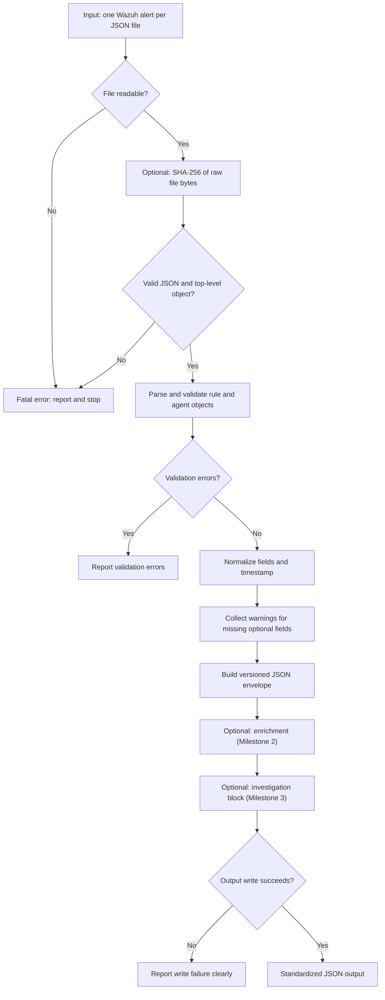

# Python SOC Automation Engine — Architecture

> **Status: draft for human review.** Architecture Specification v1.0 is approved and frozen. Only the Wazuh alert parser is implemented. Everything else in this document is **Planned** or **Proposed**.

## Status labels

| Label | Meaning |
|---|---|
| **Implemented** | Exists in the repository today and is covered by tests. |
| **Planned** | Approved in the development milestones; not yet built. |
| **Proposed** | Design detail that follows the approved specification but has not been built or finally confirmed. |

---

## 1. Project overview and objectives

Python SOC Automation Engine is an independent Python project that turns Wazuh alerts into a consistent, validated and traceable JSON record.

The project is **Wazuh-first**. The immediate goal is to make Wazuh alert processing reliable before any other SIEM platform is considered.

Objectives:

- Validate Wazuh alert input and fail clearly on bad data.
- Normalize alert fields into a documented, versioned output contract.
- Preserve the original alert so source data is never lost or silently altered.
- Keep original data, normalized fields and derived enrichment clearly separated.
- Make output explainable and evidence-based, and never invent missing values.
- Remain independently usable, with no dependency on any other platform.

Non-objectives for the current scope: live Wazuh API ingestion, support for other SIEM platforms, automated response actions, and any claim of production readiness.

---

## 2. Current implementation versus planned architecture

### Implemented

| Capability | Detail |
|---|---|
| Python project foundation | Repository and package layout. |
| Wazuh alert parser | `src/soc_automation/parser.py`, function `parse_wazuh_alert(alert: dict[str, Any])`. |
| Field extraction | Rule ID, severity, agent name and rule description. |
| Basic input validation | Within the parser. |
| Automated tests | pytest suite. Six parser tests were **last reported** as passing. This is the last reported result, **not a newly verified one**; re-run the suite to confirm the current state. |

The current input is a **Python dictionary**. There is no JSON file loading, no live Wazuh API connection and no CLI.

### Planned (by milestone)

| Milestone | Scope | Status |
|---|---|---|
| 1 — Standardized Alert Output | Validation, normalization, timestamp handling, original alert preservation, optional SHA-256, documented output contract. | Planned |
| 2 — Alert Enrichment | Verified rule metadata, severity context, supported MITRE mappings, data-quality signals, explainable enrichment. | Planned |
| 3 — Investigation-Ready Output | Investigation summary, affected endpoint, detection details, investigation status, optional case reference, evidence references, analyst notes and priority. | Planned |
| 4 — CLI and Integration Interface | Single JSON file input, CLI, standardized JSON output, error handling, repeatable processing, validation against real, sanitized Wazuh alerts exported from SENTINEL. | Planned |

**Not implemented:** normalization, enrichment, investigation management, CLI processing, SHA-256 hashing, SENTINEL integration.

---

## 3. High-level processing workflow (Proposed)

The flowchart shows the **planned** end-to-end flow for one alert file. Only the parsing step (`parse_wazuh_alert`) exists today.

Key ordering rule: when hashing is enabled, the digest is computed on the **exact original file bytes before JSON decoding**.

---

## 4. Layered architecture (Proposed)

The layers describe **responsibilities**, not a strict call chain. The processing order in section 3 is a sequence that `cli.py` orchestrates. It does not mean that each module depends on the one before it.

| Layer | Responsibility | Module | May depend on |
|---|---|---|---|
| Interface and orchestration | Read arguments, read the input file, call the other modules in order, report results and errors, set exit status. | `cli.py` | All modules below |
| Integrity | Optional SHA-256 over original input bytes. | `integrity.py` | Nothing (standard library only) |
| Parsing and validation | Extract and validate required Wazuh fields from an already decoded dictionary. | `parser.py` | Nothing in the engine |
| Schema | Define the output envelope, field types and `schema_version`. | `schema.py` | Nothing in the engine |
| Normalization | Map parsed values to the standardized `alert` structure; normalize timestamps; generate warnings. | `normalizer.py` | `schema.py` |
| Enrichment | Evidence-based, explainable additions (Milestone 2). | `enrichment.py` | `schema.py` |
| Investigation | Investigation-ready block and optional case reference (Milestone 3). | `investigation.py` | `schema.py` |

Dependency rules:

- `cli.py` is the only module that coordinates the others. No other module imports `cli.py`.
- `parser.py`, `integrity.py` and `schema.py` have no dependency on other engine modules.
- `normalizer.py` receives parser output as data. It does not call the parser or read files.
- `enrichment.py` and `investigation.py` read normalized data and `raw_alert` without modifying them. Neither is required for `normalizer.py` or `parser.py` to work.
- No module depends on SENTINEL or any external system.

Where file reading is placed (`cli.py` or a separate loader) is a **Proposed** detail. File loading is implemented separately from the parser.

---

## 5. Module responsibilities

Only `parser.py` exists today. All other modules are **Planned**; their names and boundaries are **Proposed**.

| Module | Status | Responsibility |
|---|---|---|
| `parser.py` | **Implemented** (partial) | `parse_wazuh_alert(alert: dict[str, Any])` extracts rule ID, severity, agent name and rule description, with basic validation. Planned: stricter validation of `rule` and `agent` objects (see section 7).  File loading is **not** its responsibility. |
| `normalizer.py` | Planned | Converts parsed data into the standardized `alert` structure. Parses timestamps to UTC. Sets missing optional values to `null` and records warnings. Never invents values. |
| `schema.py` | Planned | Single source of truth for the output envelope: field names, types, required versus optional, and `schema_version` (`"1.0"`). |
| `integrity.py` | Planned | Computes optional SHA-256 over the original input file bytes. Returns algorithm, scope and digest for placement in `processing.integrity`. |
| `enrichment.py` | Planned (Milestone 2) | Adds verified rule metadata, severity context, supported MITRE mappings and data-quality signals. Each item must state its basis. May be skipped with an explanation. |
| `investigation.py` | Planned (Milestone 3) | Builds the investigation-ready block: summary, affected endpoint, detection details, status, optional external case reference, evidence references, analyst notes and priority. |
| `cli.py` | Planned (Milestone 4) | Single JSON file input, standardized JSON output, clear error handling, repeatable processing. |

---

## 6. Standardized JSON output structure (Proposed)

The output is a versioned envelope with `schema_version` `"1.0"`.

| Section | Required | Responsibility |
|---|---|---|
| `schema_version` | Yes | Contract version. Consumers must check it first. |
| `record_type` | Yes | Identifies what the envelope contains. |
| `source` | Yes | Where the data came from: system, `ingestion_type` (`"file_export"` for the file-based workflow) and input file reference. Original source metadata only. |
| `alert` | Yes | **Normalized** fields: rule ID, original severity, agent name, rule description, original and normalized timestamp. |
| `processing` | Yes | Engine metadata, outcome, warnings and optional integrity metadata (`processing.integrity`). Describes what the engine did, not what the alert contains. |
| `raw_alert` | Yes | The **authoritative** preserved original parsed Wazuh alert, unmodified. |
| `enrichment` | Optional | **Derived** data (Milestone 2). Absent when not run or unavailable. |
| `investigation` | Optional | Investigation-ready data and optional case reference (Milestone 3). |

Data categories are kept separate by section:

| Category | Where it lives |
|---|---|
| Original source data | `raw_alert` (authoritative), plus corresponding original values retained in `alert` |
| Normalized fields | `alert` |
| Derived enrichment | `enrichment`, `investigation` |
| Engine metadata | `source`, `processing` (including `processing.integrity`) |

### `raw_alert` is authoritative

`raw_alert` is the authoritative preserved source object. Fields in `alert` may retain values that correspond to the original (for example, the original severity and `timestamp_original`), but they are convenience copies, not a substitute for the original alert. If `alert` and `raw_alert` ever differ in meaning, `raw_alert` is the source of truth.

`raw_alert` is the **parsed** alert, not a byte-for-byte copy of the input file. Byte-level comparison uses the optional SHA-256 in `processing.integrity` (section 9).

Full examples are in [integration-contract.md](integration-contract.md).

---

## 7. Validation and error-handling strategy

| Condition | Class | Behavior |
|---|---|---|
| Missing or unreadable input file | **Fatal error** | Report clearly and stop. |
| Invalid JSON | **Fatal error** | Report clearly and stop. |
| Top-level JSON value is not an object | **Fatal error** | Report clearly and stop. |
| `rule` or `agent` missing, `null`, or not an object | **Validation error** | Report which object and why. Do not substitute an empty dictionary. |
| `rule` or `agent` is an object but a required inner field is missing or malformed | **Validation error** | Report which field and why. |
| Missing optional field | **Warning** | Value is `null`; warning recorded in `processing`. |
| Missing or malformed timestamp | **Warning** | Normalized timestamp is `null`. |
| Enrichment unavailable | **Skip with explanation** | Not a failure. |
| Output write failure | **Reported error** | State clearly what failed and where. |

Principles:

- Never silently invent or default a value.
- A missing, `null` or malformed `rule` or `agent` object must be handled by the validation rules above. It must **not** be silently converted to an empty dictionary (for example, through `alert.get("rule", {})`), because that would hide a structural problem as a missing-field warning.
- Fail early on structural problems; warn on missing optional data.
- Messages identify the field and the reason.

How the currently **Implemented** parser treats these cases is not described here and should be confirmed against the code and tests. The rules above are the **Planned** behavior.

---

## 8. Timestamp normalization (Planned)

- Preserve the original timestamp string unchanged.
- Parse supported ISO 8601 / RFC 3339 timestamps into UTC, formatted with a trailing `Z`.
- If the timestamp is missing or malformed, the normalized value is `null` and a warning is recorded.
- Do not assume a timezone for ambiguous timestamps (for example, no offset). Set `null` and warn.

| Original | Normalized | Warning |
|---|---|---|
| `2025-01-15T10:15:30.123+00:00` | `2025-01-15T10:15:30.123Z` | No |
| `2025-01-15T12:15:30+02:00` | `2025-01-15T10:15:30Z` | No |
| `2025-01-15T10:15:30` (no offset) | `null` | Yes — ambiguous |
| `not-a-date` | `null` | Yes — malformed |
| *(missing)* | `null` | Yes — missing |

---

## 9. Optional SHA-256 integrity handling (Planned)

- SHA-256 is **optional** and off unless enabled.
- When enabled, hash the **exact original input file bytes before JSON decoding**. These are the bytes the engine processed.
- Do not hash re-serialized JSON and present it as the original-file hash.
- Record the algorithm (`sha256`), the scope (original input file bytes) and the digest in `processing.integrity`. The block is omitted when hashing is disabled.
- The digest supports **integrity comparison** of the exact bytes processed: someone holding the same file can recompute the digest and check that it matches.
- The digest does **not** establish authenticity, and it does not prove that the source is trustworthy. It does not show who created the file or that the alert is genuine.

---

## 10. Schema versioning and compatibility

- `"1.0"` is the **initial** contract version.
- Consumers must check `schema_version` before reading other fields.
- Consumers should ignore unknown optional fields.
- **Additive optional fields** may be introduced through a **minor** version (for example, `1.1`).
- **Breaking changes** require a **major** version (for example, `2.0`). These include changes to field types, field removals and changes to field semantics.

---

## 11. Human approval and safety boundaries

- The engine produces records. It does not execute response actions.
- **Human approval is required for any disruptive response action.**
- Enrichment must be explainable and evidence-based.
- The engine must not invent MITRE ATT&CK mappings or incident classifications. Only supported, verifiable mappings are allowed.
- Milestone 1 preserves the original Wazuh severity and derives no new priority or classification.
- Optional fields stay `null` when data is absent.

---

## 12. SENTINEL integration direction (Planned)

- SENTINEL may later **consume** the engine's JSON output through a file-based interface.
- Milestone 4 includes validating the engine against real, sanitized Wazuh alerts exported from SENTINEL.
- The engine stays independent. It does not import or call SENTINEL, and it requires no SENTINEL service to run.
- Case correlation is optional, through an **external case reference** that the engine stores but does not manage.

**Not implemented:** no SENTINEL integration exists today.

---

## 13. Future expansion boundaries

Support for Microsoft Sentinel, Splunk and Elastic Security may be considered after Wazuh alert processing is reliable. These are **not** current implementation requirements and are not part of Milestones 1–4. Live Wazuh API ingestion is likewise out of the current scope.
